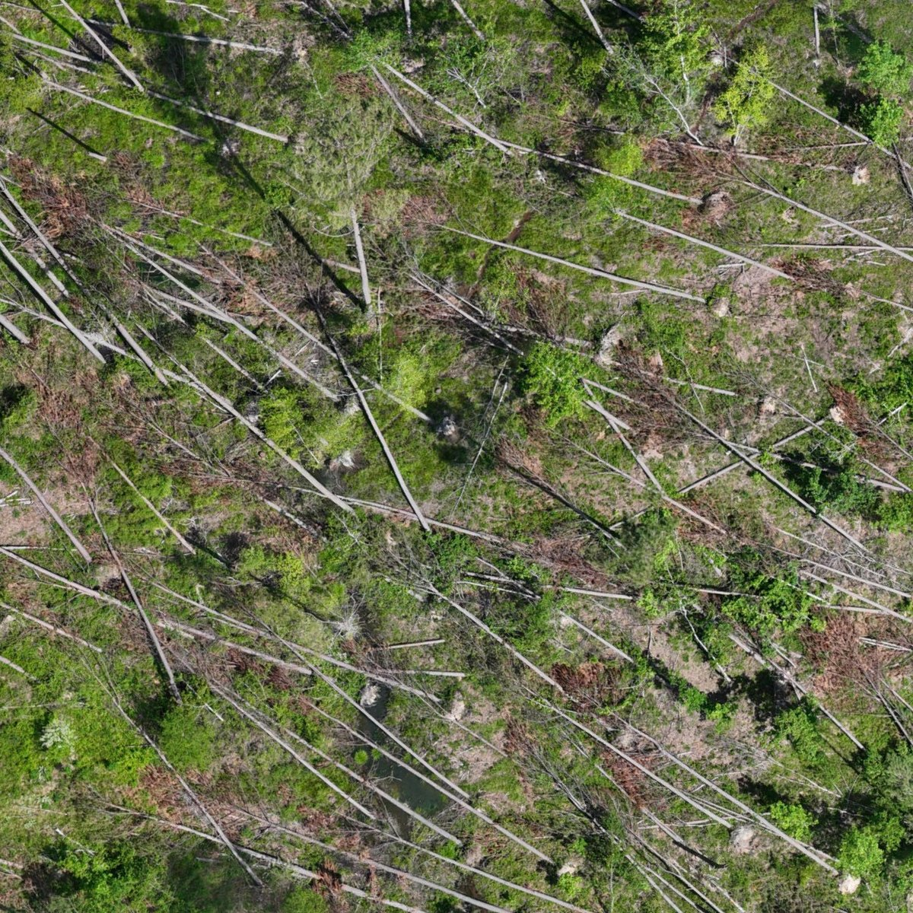
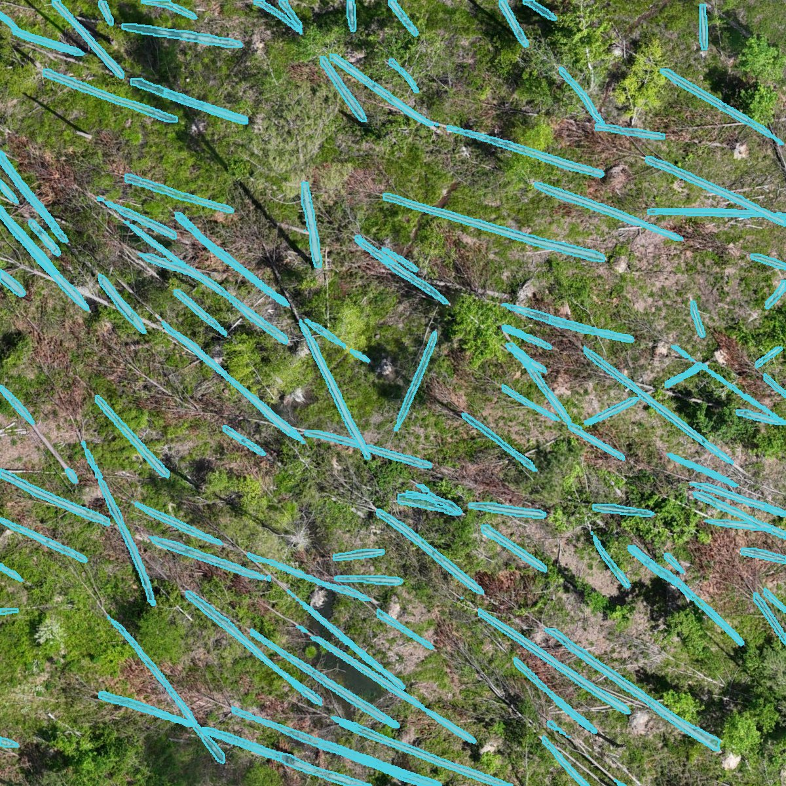
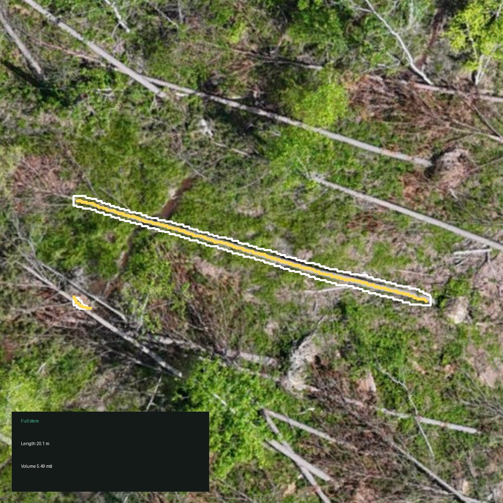
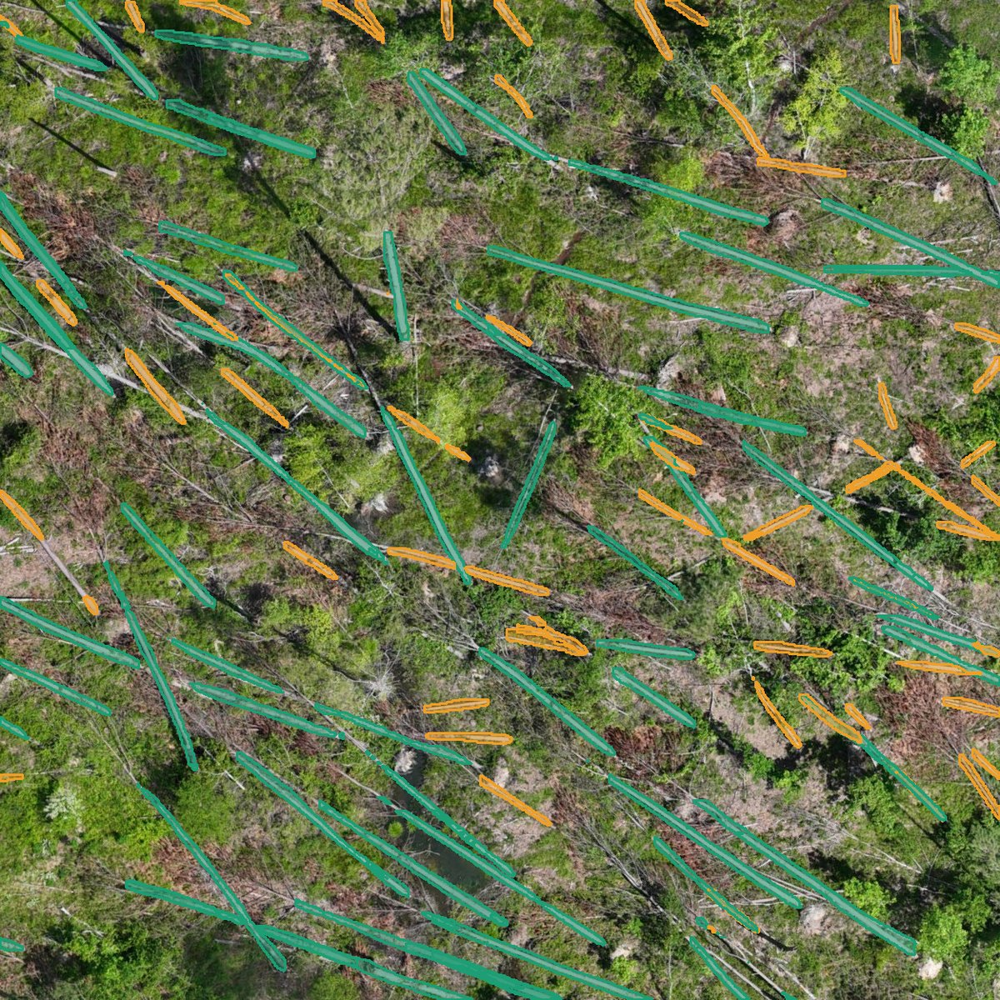
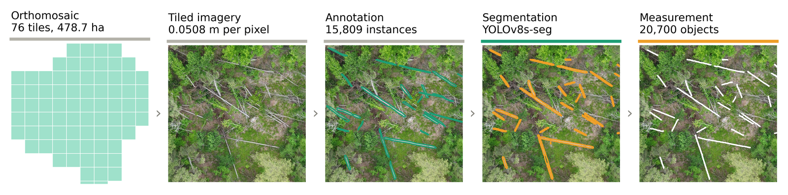
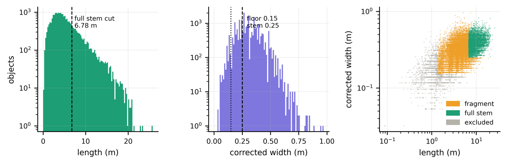
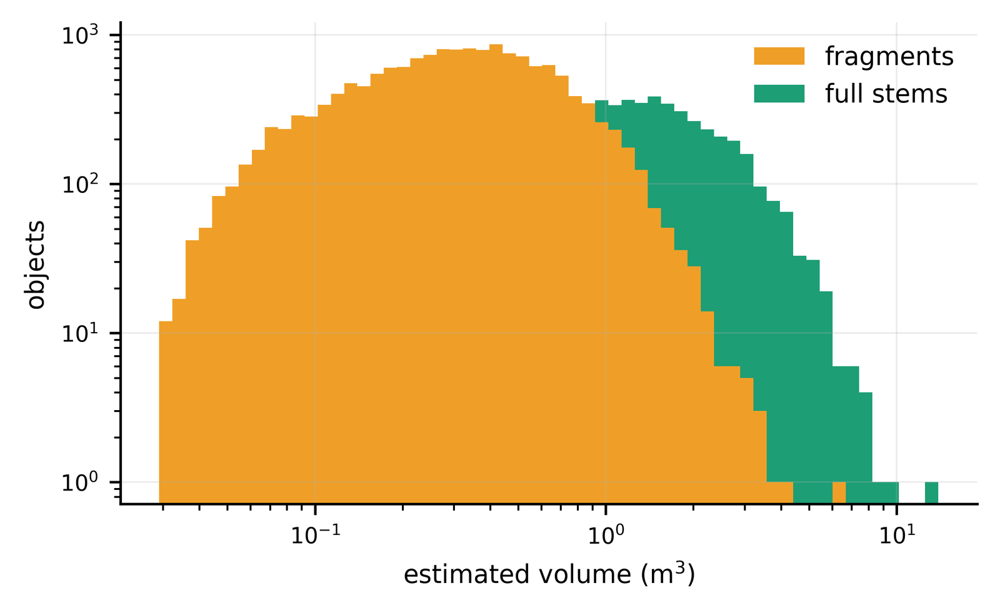
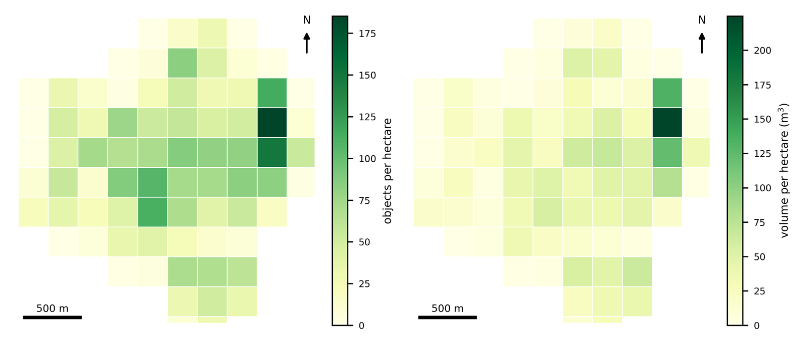
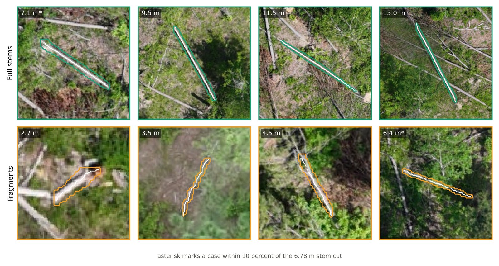

<div align="center">

# Fallen wood after Hurricane Helene, measured from the air

**A drone-based inventory of coarse woody debris on a 479-hectare windthrow site in the Georgia Coastal Plain**

[](https://ai-uga.github.io/fallen-tree-detection/)
[](configs/yolov8s_seg.yaml)
[](requirements.txt)
[](LICENSE)

AI@UGA and the Warnell School of Forestry and Natural Resources, University of Georgia

</div>

<br>

| 20,700 | 14,401 m³ | 30.1 m³/ha | 478.7 ha |
|:---:|:---:|:---:|:---:|
| pieces of downed wood counted | of wood on the ground | average across the site | surveyed at 5 cm per pixel |

Hurricane Helene left thousands of trees on the ground across private
forestland in Georgia. Counting and measuring that wood on foot is slow and
dangerous. This repository turns one drone survey into a per-piece inventory:
every detected log has an outline, a length, a volume and a class.

**[Explore the interactive density map](https://ai-uga.github.io/fallen-tree-detection/)**

## From drone image to inventory

<table>
<tr>
<td width="25%"></td>
<td width="25%"></td>
<td width="25%"></td>
<td width="25%"></td>
</tr>
<tr>
<td><b>1. Fly and tile.</b> The orthomosaic is cut into 2,500 px squares, 127 m on a side.</td>
<td><b>2. Detect.</b> YOLOv8s-seg traces every piece of fallen wood.</td>
<td><b>3. Measure.</b> Centreline, widths along it, and volume from stacked frusta.</td>
<td><b>4. Classify.</b>   </td>
</tr>
</table>

### 1. Fly and tile

A drone survey after the storm produced one orthomosaic at 5.08 cm per
pixel. It is split into 76 tiles and then into 300 squares of
2,500 × 2,500 px (1.61 ha each, smaller at the edges), the unit for both inference and density
mapping.

### 2. Detect

A YOLOv8s-seg instance segmentation model, trained on 209 images with
15,809 hand-drawn outlines, runs on every square at 1,600 px input and a
confidence threshold of 0.225, the F1 optimum on the validation split.
Across the site it finds 23,215 objects.

### 3. Measure

Each mask is reduced to a centreline. Widths are sampled perpendicular to
it at regular intervals, and volume is integrated as a chain of conical
frusta along the length. Every object gets a length, a mean width and a
volume, independent of its neighbours.

### 4. Classify

Rules in [`configs/thresholds.json`](configs/thresholds.json) sort each
piece. Long, slender pieces (at least 6.78 m long, elongation at least 12)
are **full stems**; everything else that passes the quality floors is a
**fragment**. Pieces cut by a tile edge, or too small to measure reliably,
are set aside and reported separately.

<p align="center"><br><sub>The full workflow.</sub></p>

## Results

| | Pieces | Volume | Share of volume |
|---|---:|---:|---:|
| Full stems | 5,138 | 8,266.8 m³ | 57.4% |
| Fragments | 15,562 | 6,133.8 m³ | 42.6% |
| **Inventory** | **20,700** | **14,400.6 m³** | |

Full stems are a quarter of the pieces but carry more than half of the
volume.

<table>
<tr>
<td width="50%"><br><sub>Size distributions.</sub></td>
<td width="50%"><br><sub>Inventory volume.</sub></td>
</tr>
<tr>
<td><br><sub>Volume density across the site, on an anonymized grid.</sub></td>
<td><br><sub>Detection examples.</sub></td>
</tr>
</table>

### Detection performance

42-image validation split, one pycocotools evaluator for both models
(maxDets 700, full-resolution masks).

| Model | Box AP50 | Box AP | Mask AP50 | Mask AP |
|---|---:|---:|---:|---:|
| YOLOv8s-seg | 43.0 | 21.9 | 24.9 | 5.8 |
| Mask R-CNN | 40.8 | 19.1 | 27.1 | 6.9 |

YOLOv8s-seg is the inventory model. The protocol is in
[`src/cwd/evaluate.py`](src/cwd/evaluate.py); every reported number is in
[`docs/NUMBERS.md`](docs/NUMBERS.md).

## Quick start

Verify the classification rules against the published counts. This runs
without the imagery.

```bash
git clone https://github.com/AI-UGA/fallen-tree-detection.git
cd fallen-tree-detection
pip install -r requirements.txt
PYTHONPATH=src python -m cwd.classify path/to/cwd_classified_site.csv
```

Expected: 23,215 rows, agreement 1.0000, and the six counts in
[`docs/NUMBERS.md`](docs/NUMBERS.md).

Rebuild the data behind the project page from a site run:

```bash
python scripts/build_site_data.py --site "path/to/site_run_v3"
```

> **Colour order.** Rasterio reads GeoTIFF bands as RGB; Ultralytics treats
> numpy arrays as BGR. Pass arrays through `cwd.inference.to_model_input`
> before `model.predict`, or pass a file path instead.

<details>
<summary><b>Classification rules in full</b></summary>

<br>

Tests apply in this order. The order is definitional: swapping the width
and length floors keeps the inventory count but changes the split between
the two exclusion categories.

1. `width_corr_m` below 0.15 m (three pixels): set aside
2. `length_m` below 1.37 m: set aside
3. elongation below 3.0: set aside
4. touches a tile edge: set aside, since length on a truncated mask is unreliable
5. full stem if length ≥ 6.78 m, elongation ≥ 12.0, and corrected width between 0.25 and 1.50 m
6. otherwise a fragment

`width_corr_m` is `width_mean_m / 1.19`: predicted masks are about 19%
wider than hand-drawn ones at the median. The correction applies to
classification only, never to reported volumes.

</details>

<details>
<summary><b>Repository layout</b></summary>

<br>

```
configs/
  thresholds.json      classification rules, the single source of truth
  maskrcnn.yaml        Mask R-CNN architecture and solver
  yolov8s_seg.yaml     YOLOv8s-seg training arguments
src/cwd/
  paths.py             locate the data root by content, never by hardcoded path
  inference.py         convert raster tiles to the colour order the model expects
  volume_pipeline.py   per-object measurement and frustum volume
  classify.py          inventory and exclusion labels, with a self-test
  evaluate.py          unified pycocotools scoring for both models
  figures.py           figure style and save helpers
notebooks/
  02_detection.ipynb   site-wide inference, measurement and classification
scripts/
  build_site_data.py   anonymized per-square data for the project page
  preflight.sh         pre-commit scan
  fetch_data.py        download the Zenodo deposit
docs/
  index.html           project page, served by GitHub Pages
  NUMBERS.md           every reported number
  REPRODUCE.md         pipeline order and practical notes
  DATA.md              what is released and how to request the rest
  FIGURES.md           figure conventions
```

</details>

<details>
<summary><b>Environment</b></summary>

<br>

PyTorch 2.11.0+cu128, Detectron2 0.6, Ultralytics 8.4.101, Python 3.12,
CUDA 12.8. Detectron2 has no PyPI release and must be built from source.

</details>

## Data

The site is privately owned land, so the orthomosaic and georeferenced
products are not released. Model weights, the annotation set with
georeferencing removed, and example crops go to Zenodo. Requests for the
full dataset go to the corresponding author. See
[`docs/DATA.md`](docs/DATA.md).

Volumes are image-based estimates and have not been calibrated against field
measurement. Counts are conservative, since small pieces are the hardest to
detect.

## Team

Dang Hoang, Rishab Subramaniyan, Owen Norman, Joey Hattan, and
Roger C. Lowe III (corresponding author).
AI@UGA and the Warnell School of Forestry and Natural Resources, University
of Georgia; Brown University.

## Citation

See [`CITATION.cff`](CITATION.cff). The paper is in preparation. Code is MIT
licensed; the data deposit is CC BY 4.0.
